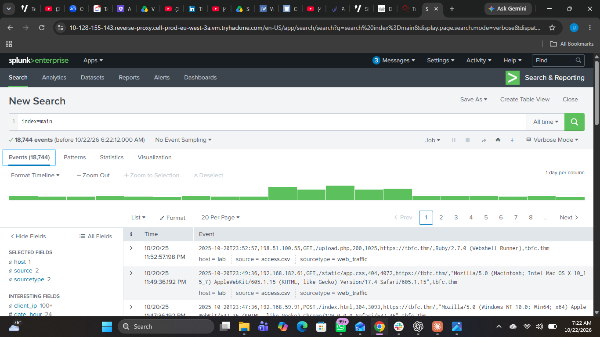
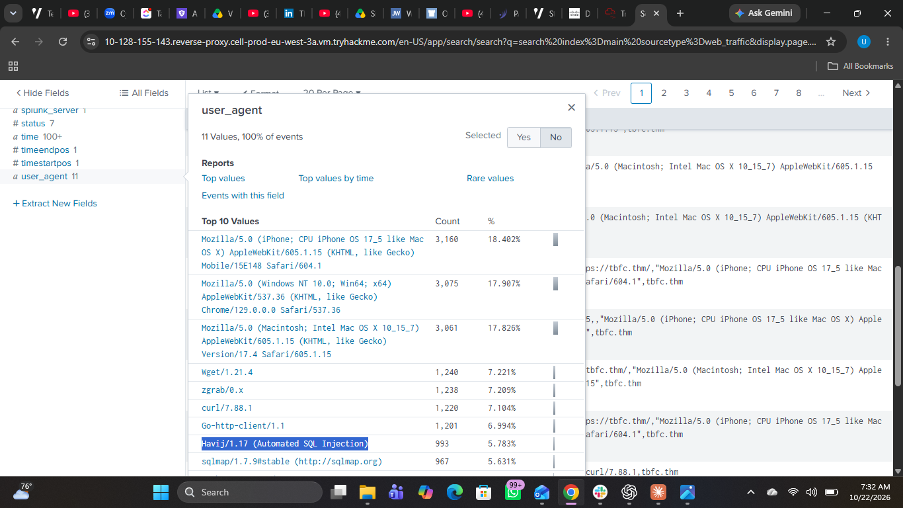
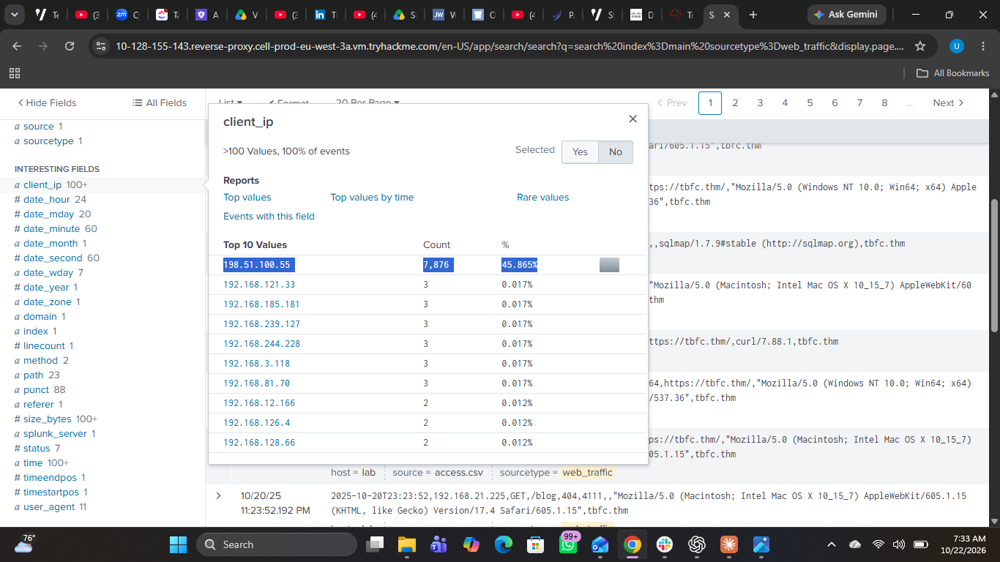
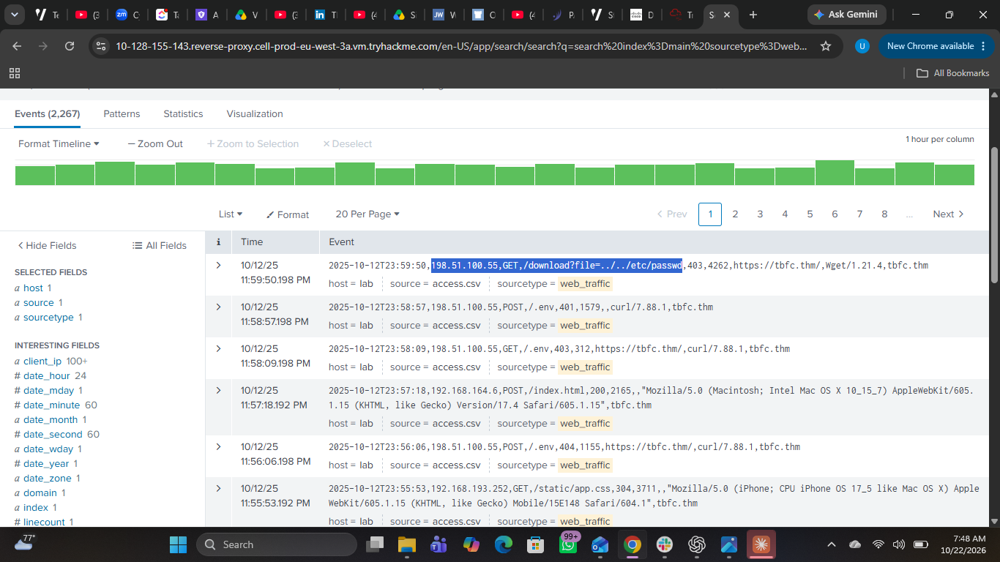
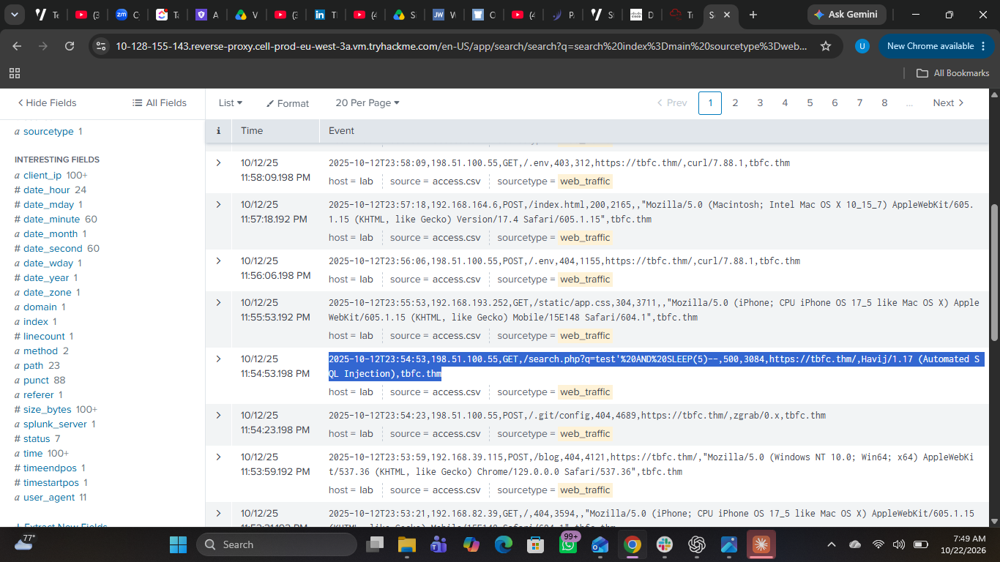
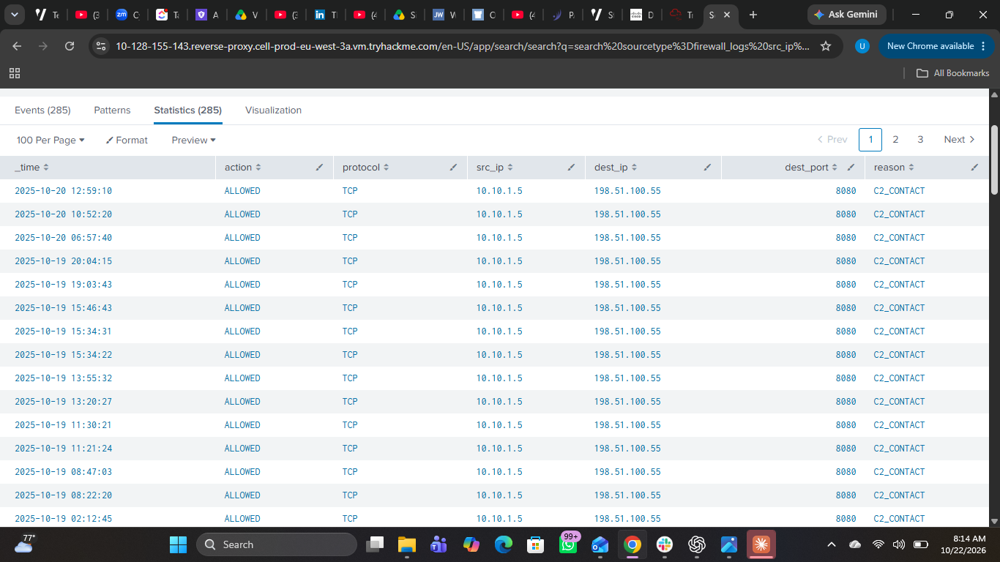

# Splunk Ransomware Investigation: From Web Reconnaissance to C2 Communication

## 1. Objective

The objective of this investigation was to analyse a simulated ransomware incident using Splunk, identify suspicious web activity, trace potential exploitation attempts, and investigate outbound command-and-control (C2) communication.

Using web traffic and firewall logs from the lab environment, the investigation focused on identifying indicators of compromise, correlating related events, and reconstructing the sequence of activity leading to the suspected ransomware execution.

## 2. Investigation Preview

This investigation was conducted in the **Splunk Basics – Did You SIEM?** room on TryHackMe as part of Advent of Cyber 2025.

The scenario involved investigating suspicious activity against a web server, from reconnaissance and attempted exploitation to a request associated with ransomware execution. The investigation then pivoted to firewall logs to examine outbound connections associated with command-and-control communication.

The primary data sources were:

- `web_traffic` — used to investigate HTTP requests, suspicious source IPs, requested paths, and exploitation indicators.
- `firewall_logs` — used to investigate outbound network connections and traffic identified by the lab as C2-related.

The investigation followed a structured approach: establish the available data, identify anomalies, trace suspicious activity, correlate findings across log sources, and document the evidence.

## 3. Lab Environment

| Component | Description |
|---|---|
| SIEM platform | Splunk |
| Practical environment | TryHackMe |
| Lab | Splunk Basics – Did You SIEM? |
| Event index | `main` |
| Primary data sources | `web_traffic`, `firewall_logs` |
| Investigation focus | Web reconnaissance, exploitation indicators, ransomware execution, and C2 communication |

## 4. Investigation Process

### 4.1 Initial Log Exploration

I began by opening Splunk's **Search & Reporting** interface and running an initial search to explore the available events:

```spl
index=main
```

I selected the **All time** range to review the available dataset and identify the log sources relevant to the investigation.

The initial exploration revealed two key data sources, `web_traffic` and `firewall_logs`. I started with the web traffic events to investigate suspicious requests and identify patterns that could indicate reconnaissance or attempted exploitation.



*Figure 1: Initial Splunk search used to explore events in the main index.*

### 4.2 Identifying Suspicious Web Activity

I narrowed the investigation to web traffic and examined the event timeline, extracted fields, User-Agent values, and source IP addresses.

Unusual User-Agent values and abnormal requests to web server paths provided leads for further investigation. Rather than treating each event in isolation, I filtered out common browser User-Agent values and examined the source IPs associated with the remaining activity.

The lab investigation identified `198.51.100.55` as the suspicious source IP address. I used this as a pivot to examine related requests and understand the activity associated with that source.



*Figure 2: Web traffic analysis showing unusual User-Agent values.*



*Figure 3: Web traffic events associated with the suspicious source IP.*

### 4.3 Investigating Reconnaissance and Exploitation Indicators

I followed the suspicious source IP through the web traffic logs and examined requests targeting sensitive paths, including `/.env` and `.git`.

These requests were relevant because exposed configuration files and repository metadata can contain sensitive information. I also observed path-traversal attempts and HTTP responses including `404`, `403`, and `401`, which provided context about the requests and the server's responses.

The investigation then moved to SQL injection indicators. Relevant events included references to tools such as `sqlmap` and `Havij`, as well as payloads containing `SLEEP(5)`.

Taken together, these patterns were consistent with systematic reconnaissance and attempted exploitation. However, individual failed requests alone do not establish that sensitive information was successfully accessed or that SQL injection succeeded.



*Figure 4: Requests targeting sensitive web server paths.*



*Figure 5: Web traffic containing SQL injection indicators and suspicious payloads.*

### 4.4 Tracing Activity Associated with Ransomware Execution

I continued by examining requests involving potentially sensitive archives, including `backup.zip` and `logs.tar.gz`, alongside activity involving `shell.php`.

One request was particularly significant:

```text
/shell.php?cmd=./bunnylock.bin
```

The lab identified this request as evidence associated with remote command execution and ransomware payload execution on the web server.

This finding connected the earlier reconnaissance and exploitation indicators to the suspected execution stage of the incident. The request provides evidence of an attempted command through a web-accessible script; the conclusion that ransomware executed is based on the lab's interpretation rather than the HTTP request alone.

### 4.5 Pivoting to Firewall Logs for C2 Communication

After investigating the web traffic, I pivoted to the firewall logs to examine outbound connections from the potentially compromised server.

The relevant events included allowed traffic marked with the reason `C2_CONTACT`. This provided evidence that the lab associated the outbound connections with command-and-control activity.

Rather than stopping at the web server logs, I used the firewall data to extend the investigation into network communication. This cross-source approach helped connect the suspected host compromise with outbound traffic to an external destination.



*Figure 6: Firewall events showing allowed traffic marked `C2_CONTACT`.*

### 4.6 Examining Transferred Data Volume

I also examined the `bytes_transferred` field and used statistical analysis to investigate the total volume associated with the relevant connections.

I recalled a result of approximately **126,000 bytes**, but this figure has not yet been verified against the saved evidence and should therefore be treated as provisional.

The volume alone does not establish the purpose of the transfer or confirm data exfiltration. Its significance depends on the destination, connection context, event details, and other supporting evidence.

## 5. Attack Timeline

Based on the activity described in the lab, the investigation followed this sequence:

1. **Reconnaissance:** Requests targeted sensitive web server paths and resources.
2. **Exploitation attempts:** Path-traversal and SQL injection indicators appeared in the web traffic.
3. **Suspected command execution:** A request involving `shell.php` and `bunnylock.bin` was identified by the lab as ransomware-related execution activity.
4. **C2 communication:** Firewall events marked `C2_CONTACT` indicated outbound traffic associated with command-and-control activity.
5. **Traffic-volume analysis:** The `bytes_transferred` field was examined to assess the volume associated with the relevant connections.

This timeline represents the sequence of activity investigated. Exact timestamps and the transfer-volume result should be confirmed against the underlying events before being reported as verified findings.

## 6. Conclusion

This investigation demonstrated how Splunk can be used to investigate a simulated ransomware incident by examining web traffic, identifying suspicious requests, and pivoting to firewall logs for network-level evidence.

The key lesson was the importance of correlating multiple data sources. Web requests provided indicators of reconnaissance and attempted exploitation, while firewall events added context about outbound communication associated with C2 activity.

The exercise reinforced an evidence-first approach to incident investigation: identify anomalies, follow related events, assess what the logs actually establish, and distinguish observed facts from conclusions that require additional verification.

## 7. Skills Demonstrated

- Splunk Search Processing Language (SPL) fundamentals.
- Log exploration and event filtering.
- Analysis of suspicious User-Agent values, source IPs, and HTTP requests.
- Identification of reconnaissance, path-traversal, and SQL injection indicators.
- Investigation of suspected remote command execution and ransomware activity.
- Correlation of web traffic and firewall logs.
- Analysis of outbound connections and transferred-byte fields.
- Evidence-based incident timeline development.

## 8. References

- **TryHackMe:** [Splunk Basics – Did You SIEM?](https://tryhackme.com/)
- **Learning path:** Splunk Cybersecurity Defense Analyst.

*This report documents a simulated, educational investigation. Findings and conclusions are limited to the lab evidence described above.*

