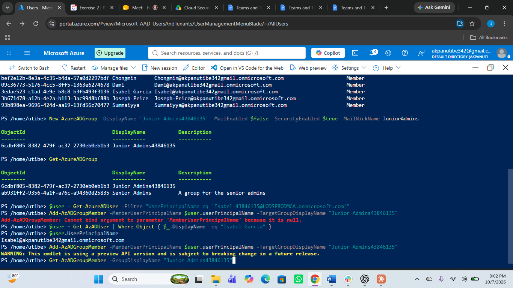
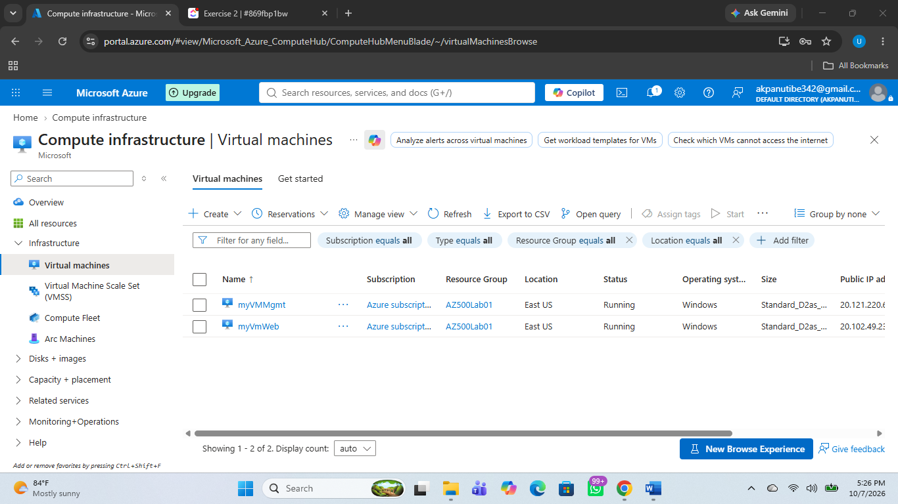
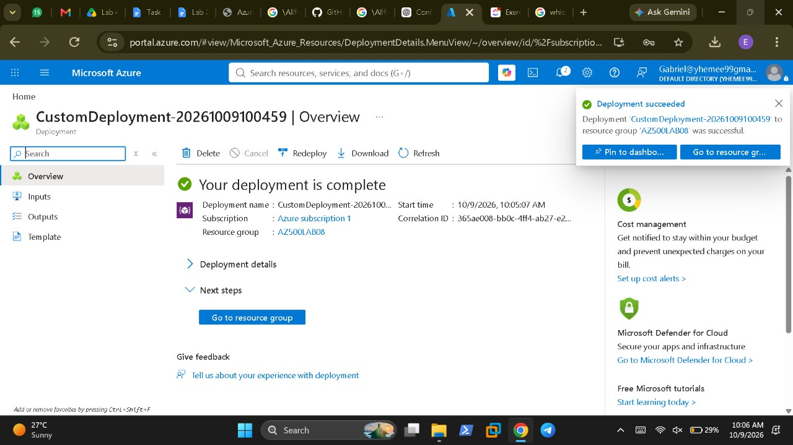
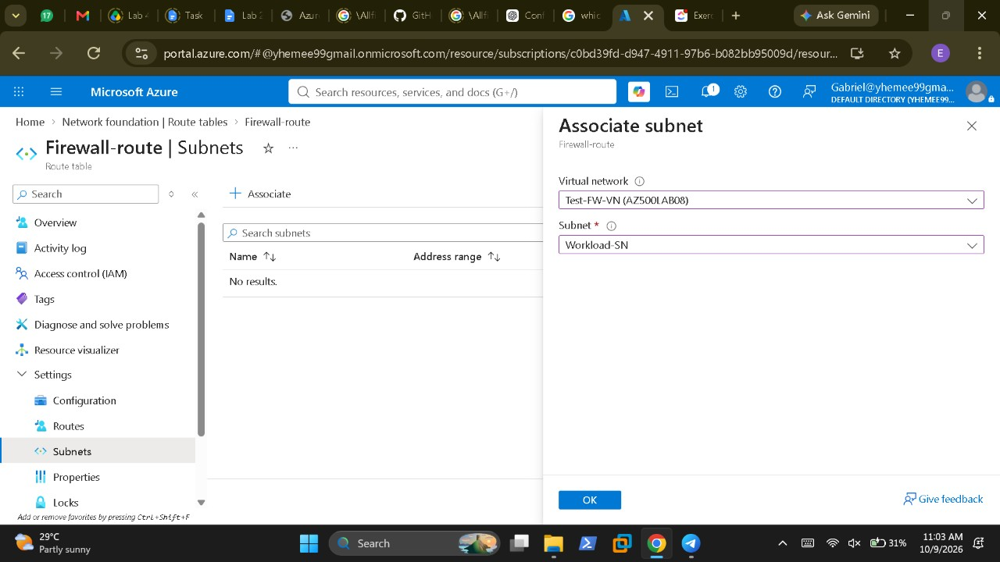
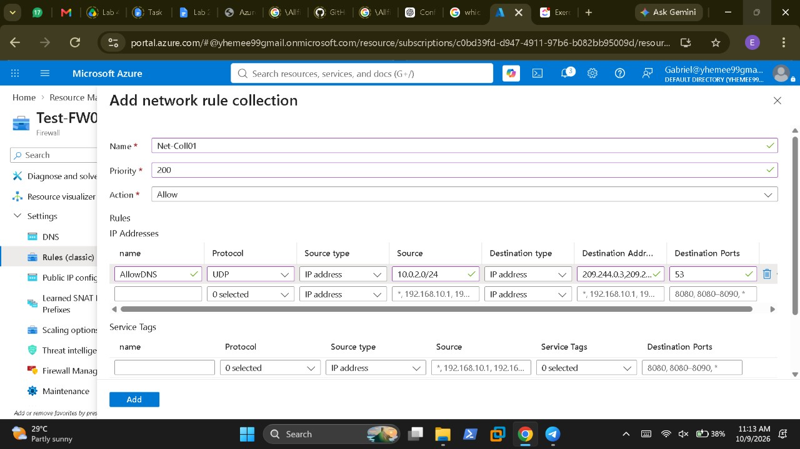
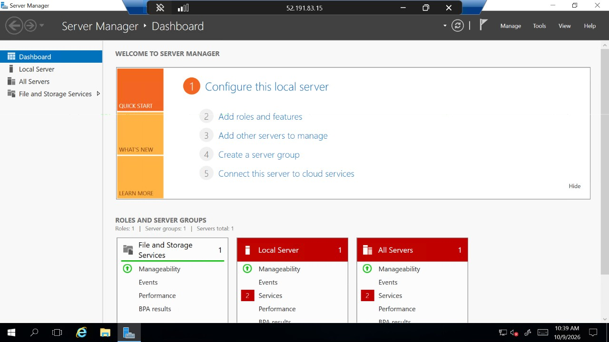
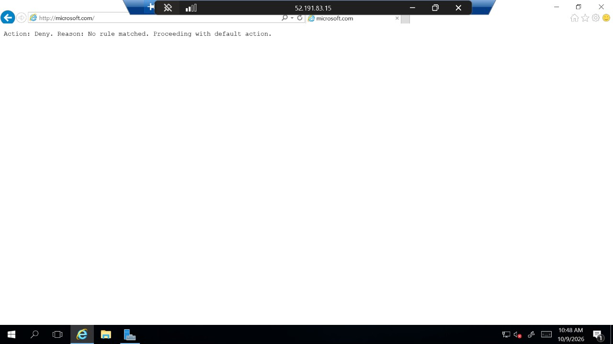

# StashingFintech Cloud Security

## Introduction

StashingFintech is a simulated payments company headquartered in Lagos, Nigeria, providing payment infrastructure and APIs to businesses across Africa. As a payments-focused organization operating in a cloud environment, its security requirements include protecting access to cloud resources, controlling network traffic, securing workloads and data, monitoring activity, and responding to potentially unauthorized changes.

During Sprint 2 of the CyBlack Internship's September 2026 cohort, our team worked as StashingFintech's cloud security team to address these requirements through the implementation and testing of security controls in Microsoft Azure.

The project followed a practical, needs-driven approach. Rather than simply configuring services, we examined how each control could address a specific security requirement, implemented the relevant configuration, and tested its behaviour to determine whether it achieved the intended outcome.

For example, access permissions needed to be assigned appropriately, network traffic needed to be restricted according to defined rules, storage needed protection against unauthorized access, and suspicious changes to cloud resources needed to be detected. The team also evaluated monitoring and automated response capabilities to understand how security events could be identified and handled.

The work covered identity and access management, network security, container workloads, storage protection, logging and monitoring, virtual machine security, and security incident detection and response.

## Project Objective

The objective was to implement and evaluate Microsoft Azure security controls that address the access control, network protection, workload security, data protection, visibility, and incident response requirements of the simulated StashingFintech environment.

The project aimed to:

- **Enforce appropriate access:** Ensure that permissions are assigned at the appropriate scope and that access can be managed through group membership and role-based access control.
- **Restrict network exposure:** Control connectivity to workloads and management services through network security groups, application security groups, and Azure Firewall.
- **Protect workloads and data:** Apply appropriate security controls to container workloads and restrict access to storage resources based on the configured network controls.
- **Improve security visibility:** Collect and monitor relevant Azure activity and configure security monitoring capabilities.
- **Reduce unnecessary management-port exposure:** Evaluate just-in-time virtual machine access to limit when and from where management access is available.
- **Detect and respond to security-relevant changes:** Configure and test Microsoft Sentinel detection and automation workflows, identifying both successful detection and any limitations in the response process.

The project was considered through practical configuration and verification: each security control needed to be assessed against its intended purpose, with observed results, implementation challenges, and recommendations documented to inform stronger cloud security practices.

## Scope and Environment

### Scope

The project covered nine Microsoft Azure security labs focused on implementing and testing controls across the cloud environment. The scope included:

- Identity and access management using Microsoft Entra ID and Azure RBAC.
- Network traffic filtering using NSGs, ASGs, and Azure Firewall.
- Container workload security using Azure Container Registry and Azure Kubernetes Service.
- Storage access restrictions using service endpoints and storage firewall rules.
- Log collection and monitoring using Azure Monitor and Log Analytics.
- Cloud workload protection using Microsoft Defender for Cloud.
- Just-in-time access for virtual machines.
- Security event detection and automated response using Microsoft Sentinel.

Each area was evaluated against its intended security purpose. Configurations were tested, observed results were documented, and implementation limitations were recorded where the expected outcome was not achieved.

### Environment and Tools

The project was implemented in **Microsoft Azure**, primarily through the Azure portal and Azure Cloud Shell, using Bash and PowerShell for configuration and resource management.

The Azure services used included Microsoft Entra ID, Azure RBAC, NSGs, ASGs, Azure Firewall, Azure Container Registry, Azure Kubernetes Service, Azure Storage, Azure Monitor, Log Analytics, Microsoft Defender for Cloud, and Microsoft Sentinel.

Resources were generally deployed in the East US region, subject to subscription limits and service availability.

**Environment limitations:** Azure free-trial quotas restricted some virtual machine sizes, and Azure Container Registry Tasks were unavailable. Some supplied lab instructions were missing or outdated, and configuration errors were identified during testing. These limitations are considered in the relevant findings and outcomes documented below.

## 1. Identity and Access Management (RBAC)

### Security Requirement

StashingFintech requires controlled access to its Azure resources. Users should receive only the permissions required for their responsibilities, and access should be managed in a way that can be reviewed and revoked without relying on individual role assignments.

The objective was to establish role-based access control (RBAC) by creating user accounts and groups, then assigning permissions through group membership at a defined resource scope.

### Implementation

Three user accounts and three security groups were created using different Azure administration tools:

- **Joseph Price:** Created through the Azure portal and associated with the Senior Admins group.
- **Isabel Garcia:** Created using PowerShell in Azure Cloud Shell and associated with the Junior Admins group.
- **Dylan Williams:** Created using Azure CLI in Bash and associated with the Service Desk group.

The **Virtual Machine Contributor** role was assigned to the Service Desk group at the `AZ500Lab01` resource group scope. This allowed Dylan Williams to receive the role through group membership rather than through a direct assignment to his individual account.

The role was scoped to the resource group instead of being assigned at subscription level, limiting the assignment's reach.

### Verification and Evidence

The configuration was verified by checking that the user accounts and groups existed and reviewing the effective role assignments on `AZ500Lab01`.

**Evidence 1 — User accounts created**

The Azure CLI user list confirmed that the three lab accounts existed in the tenant.

**Evidence 2 — Group membership**

The group membership check confirmed that Dylan Williams was a member of the Service Desk group.

**Evidence 3 — Role assignment review**

During verification, the Virtual Machine Contributor role was found assigned both to the Service Desk group and directly to Dylan Williams. The direct assignment was removed to ensure that his access depended on group membership.

The final check showed the role assignment through the Service Desk group. Joseph Price had no role assignment on `AZ500Lab01`, as expected.

### Outcome

The lab demonstrated how Azure RBAC can be used to manage access through groups and restrict permissions to a specific resource group. Dylan Williams' access to the resources covered by the assignment depends on his membership in the Service Desk group, making access management easier to review and maintain.

The verification process also exposed an unintended direct role assignment that had remained from an earlier attempt. Removing it reinforced the importance of reviewing effective permissions after configuration, rather than assuming that the intended access model has been applied correctly.

## 2. Network Security Groups and Application Security Groups

### Security Requirement

StashingFintech requires network access to be controlled according to each server's function. Web servers must accept legitimate web traffic, while remote management access should be restricted to designated management systems rather than exposed to every workload.

### Implementation

A Network Security Group (NSG) was configured with Application Security Groups (ASGs) to distinguish between web servers and management servers by their roles.

The configuration used two application security groups:

- **Web server ASG:** Identified workloads intended to serve web traffic.
- **Management server ASG:** Identified workloads intended to receive remote management connections.

The NSG rules used these groups as traffic-matching criteria, allowing access to be controlled by server role instead of relying solely on individual IP addresses.

### Verification and Evidence

Connectivity tests were performed against both servers to confirm that the rules enforced the intended access restrictions.

The management server accepted Remote Desktop Protocol (RDP) connections, while the web server refused RDP connections. The web server continued to serve HTTP traffic, confirming that restricting management access did not prevent its intended web function.

### Outcome

The tests confirmed that a single NSG could apply different access policies to workloads based on their application security group membership. The management server remained accessible through RDP, while the web server accepted HTTP traffic without allowing the tested RDP connection.

This approach supports least-privilege network access by allowing only the traffic required for each server's role.

## 3. Azure Firewall

### Security Requirement

StashingFintech requires control over outbound network traffic to reduce unnecessary external connections and limit workloads to approved destinations. DNS resolution must also remain functional so that permitted services can be reached by domain name.

### Implementation

Azure Firewall was deployed to inspect and filter outbound traffic from the workload subnet. A route directed workload traffic through the firewall, while application and network rule collections defined which destinations and services were permitted.

The application rule collection, `AllowGH`, allowed access to `www.bing.com`. A network rule collection, `Net-Coll01`, included the `AllowDNS` rule to permit DNS traffic to the configured DNS servers. Traffic without a matching allow rule was denied by the firewall's default action.

### Verification and Evidence

Testing was performed from the workload virtual machine, `Srv-Work`, through a remote desktop session on `Srv-Jump`.

Access to `www.bing.com` succeeded, demonstrating that the application rule permitted the request. Access to `www.microsoft.com` was denied, with the firewall returning `Action: Deny` and `Reason: No rule matched`. DNS resolution worked for both domains, confirming that the configured DNS rule was functioning.

### Outcome

The tests confirmed that Azure Firewall controlled outbound access according to the configured rules: the approved destination was reachable, while the destination without a matching allow rule was blocked.

The deployment also exposed configuration and template issues that required correction before testing. The firewall's public IP configuration needed a Standard SKU with static allocation, and the virtual machine size had to be adjusted to fit the subscription's available capacity. The lab also highlighted the importance of reviewing externally sourced deployment templates before use, particularly for embedded credentials and outdated configurations.

## 4. Azure Container Registry and Azure Kubernetes Service

### Security Requirement

StashingFintech requires container images to be stored securely, workloads to retrieve images without embedded credentials, and application services to be exposed only through their intended network boundaries. Public-facing services must be reachable externally, while internal services should remain accessible only within the private network.

### Implementation

A private Azure Container Registry (ACR) was configured to store the NGINX container image. Because Azure Container Registry Tasks were unavailable under the subscription, the official NGINX image was imported from Docker Hub into the private registry as `sample/nginx:v1`.

An Azure Kubernetes Service (AKS) cluster named `MyKubernetesCluster` was deployed with two nodes. The cluster was connected to the private registry using its kubelet managed identity, which received the `AcrPull` role to retrieve images without storing registry passwords.

Two Kubernetes services were configured for different exposure requirements:

- **Public service (`nginxexternal`):** Exposed NGINX through an external load balancer.
- **Internal service (`nginxinternal`):** Exposed NGINX through an internal load balancer using a private IP address.

The cluster's managed identity was also granted Contributor permissions on the virtual network to support the internal load balancer configuration.

### Verification and Evidence

The deployment was tested to confirm that AKS could retrieve the container image from the private registry and that the two services enforced their intended exposure boundaries.

The public load balancer received an external IP address, and browsing to it displayed the NGINX welcome page. This confirmed that the container workload was running and reachable through the public endpoint.

The internal load balancer was tested from outside the virtual network, where the connection timed out. A subsequent `curl` request from inside a pod successfully reached the internal service, confirming that it was accessible from within the cluster's network environment.

### Outcome

The tests confirmed that the private registry and AKS deployment worked together, with registry access provided through managed identity rather than stored credentials. The public service was reachable externally, while the internal service responded from within the cluster but was not reachable from the external laptop.

The subscription restriction on Azure Container Registry Tasks required an alternative image-import method. This preserved the objective of pulling an image from a private registry, although the image was imported rather than built through the lab's intended ACR Tasks workflow.

The deployment demonstrated how managed identities, private image storage, and separate public and internal load balancers can support workload security and network segmentation in Azure.

## 5. Azure Storage Security

### Security Requirement

StashingFintech needs to protect stored data from unauthorized network access without unnecessarily restricting legitimate connectivity. Access to the storage account should be available only to workloads in the approved private subnet, while resources in the public subnet should retain internet connectivity without gaining access to the protected storage share.

### Implementation

Azure Storage network restrictions were configured to limit access to the storage account to the designated **Private subnet**. A virtual network service endpoint and storage firewall rules were used to control which subnet could access the storage service, while network security controls governed internet connectivity.

The configuration was designed to enforce two separate requirements:

- **Private subnet:** Allow access to the approved Azure file share while restricting internet access.
- **Public subnet:** Allow internet access while denying access to the protected storage share.

### Verification and Evidence

The configuration and connectivity tests were used to verify that the storage firewall and network controls enforced the intended access boundaries.

From `myVmPrivate`, the Azure file share was successfully mapped as drive `Z:`, confirming that the approved subnet could access the storage resource.

From `myVmPublic`, access to the storage share was refused, while internet access remained available. This demonstrated that internet connectivity did not grant the public-subnet workload access to the protected storage account.

### Outcome

The tests demonstrated that storage access and internet connectivity could be controlled independently. The private subnet could access the approved file share but was restricted from internet access, while the public subnet retained internet connectivity but could not access the protected storage share.

This configuration supports **network-based data protection** by limiting storage access to an explicitly approved subnet rather than allowing access from every workload in the virtual network.

## 6. Azure Logging and Monitoring

### Security Requirement

StashingFintech needs visibility into the health and activity of its cloud workloads. Without centralized collection of monitoring data, administrators may struggle to identify performance issues, investigate unexpected behaviour, or establish a reliable record of system activity.

### Implementation

An Azure monitoring solution was configured to collect virtual machine performance data and send it to a centralized Log Analytics workspace for analysis.

The implementation included:

- **Azure virtual machine:** Deployed as the workload to be monitored.
- **Log Analytics workspace:** `lgawIgnite`, used as the central destination for collected monitoring data.
- **Azure Monitor Agent:** Used to collect the data specified by the monitoring configuration.
- **Data Collection Rule (DCR):** `DCR1`, configured with a performance-counter data source to define the metrics collected from the virtual machine.

This configuration established a collection path from the monitored workload to the Log Analytics workspace, providing a foundation for centralized monitoring and troubleshooting.

### Verification and Evidence

The virtual machine reported a successful provisioning state, and the Data Collection Rule showed the selected performance counters routed to the Log Analytics workspace.

These checks confirmed that the collection rule was configured with the intended data source and destination. The lab verified the monitoring pipeline configuration; it did not document a separate query demonstrating actual metric records arriving in the workspace.

### Outcome

The lab established the foundation for centralized Azure workload monitoring. With the virtual machine, Azure Monitor Agent, Data Collection Rule and Log Analytics workspace configured, the environment was prepared to collect performance data for analysis and troubleshooting.

The workspace was also reused by later labs involving Microsoft Defender for Cloud, just-in-time VM access and Microsoft Sentinel, connecting workload monitoring with the wider cloud security monitoring environment.

## 7. Microsoft Defender for Cloud

### Security Requirement

StashingFintech needs to strengthen protection for its cloud servers by improving visibility into potential threats and vulnerabilities. Virtual machines supporting business services should be monitored, with security capabilities enabled to help reduce exposure to attacks.

### Implementation

Microsoft Defender for Cloud was used to enable the **Defender for Servers Plan 2** at the Azure subscription level.

The Servers plan was changed from **Off** to **On** and saved. The configuration applied at the subscription level and covered the virtual machine `myVM`, which was deployed in Lab 6.

Enabling this plan also made the just-in-time (JIT) virtual machine access capability available for the subsequent lab.

### Verification and Evidence

The subscription's Defender plans page showed the Servers plan enabled, with one server covered. This confirmed that the security plan was active for `myVM`.

The JIT access option subsequently became available for `myVM`, confirming that the prerequisite for the next lab had been established.

### Outcome

Microsoft Defender for Servers Plan 2 was enabled, providing security capabilities for the covered virtual machine and making just-in-time access available for the next stage of the project.

No implementation issues were recorded in this lab. However, Defender for Servers Plan 2 can incur charges after the initial 30-day period. This highlights the importance of considering subscription costs when enabling cloud security plans.

## 8. Just-in-Time Virtual Machine Access

### Security Requirement

StashingFintech needs to protect its virtual machines from unauthorized remote access and reduce exposure to brute-force attacks. Management ports such as Remote Desktop Protocol (RDP) on TCP port `3389` should not remain continuously accessible. Access should be granted only when required, for a limited period, and from an approved source IP address.

### Implementation

Microsoft Defender for Cloud's **Just-in-Time (JIT) VM access** was enabled for the virtual machine `myVM`.

The default JIT policy was used to protect RDP on TCP port `3389`, with a maximum access duration of three hours. The policy allowed the requesting user's source IP address to be specified when requesting access.

Under this configuration, the management port remains restricted until access is requested and approved. The associated network security rules then permit access for the approved source address and time window.

### Verification and Evidence

Microsoft Defender for Cloud listed `myVM` as a virtual machine configured for JIT access, confirming that the policy was enabled.

After an access request was approved, the VM connection page confirmed that RDP access on port `3389` was available from the requesting IP address. The RDP connection then succeeded.

These checks demonstrated that remote management access could be granted when needed rather than leaving the port continuously exposed.

### Outcome

JIT access was successfully configured and tested for `myVM`. The control reduces the period during which the RDP management port is accessible and limits access to the approved source IP address during the authorized window.

This provides a stronger approach than leaving RDP continuously open through network security rules. The lab also established a security-relevant change for the next stage: removing the JIT policy would be used to test detection and response in Microsoft Sentinel.

## 9. Microsoft Sentinel for SIEM and SOAR

### Security Requirement

StashingFintech needs centralized security monitoring to detect unauthorized changes to cloud resources and initiate an appropriate response. Removing a Just-in-Time (JIT) access policy could expose a virtual machine's management port, so this activity should generate a security alert and trigger an automated response workflow.

### Implementation

Microsoft Sentinel was added to the existing Log Analytics workspace `lgawIgnite` in the resource group `AZ500LAB131415`.

The following components were configured:

- **Azure Activity connector:** Connected Azure Activity logs to the workspace through an Azure Policy assignment at subscription scope, including a remediation task.
- **Built-in analytics rule:** Enabled the template rule `Suspicious number of resource creation or deployment activities` with Medium severity.
- **Custom analytics rule:** Created `Playbook Demo` to detect deletion of a JIT network access policy through the Azure Activity operation `Microsoft.Security/locations/jitNetworkAccessPolicies/delete`. The rule ran every five minutes, with its lookback period extended to one hour.
- **Playbook:** Deployed the `Change-Incident-Severity` Logic App with one trigger and three actions. Its four API connections were authorized.
- **Automation rule:** Configured Sentinel to run the playbook when an alert generated by `Playbook Demo` was created. Sentinel was granted the required playbook permissions.

### Verification and Evidence

The `Change-Incident-Severity` Logic App was deployed and showed an enabled status, confirming that the playbook was available for the response workflow.

To test the detection-and-response chain, the JIT policy was removed from `myVM`. The custom detection worked, Sentinel generated incidents, and the automation rule triggered the playbook.

However, the playbook executions failed at the incident lookup step. The lookup returned `NotFound`, so the automated severity change was not applied. This meant that detection and playbook triggering worked, but the complete response workflow was not successful.

### Outcome

The lab established a working detection path for the removal of a JIT access policy, connecting Azure Activity logs, Sentinel analytics, incident creation, and automated playbook triggering.

**The main limitation was in the response stage:** the playbook could be triggered, but its incident lookup failure prevented the severity update. The result demonstrates why security automation must be tested end to end; successful alert generation does not necessarily mean the intended response has completed.

For a production deployment, the incident lookup and permissions would need further troubleshooting and validation before relying on the playbook to modify incident severity automatically.

## Key Findings and Recommendations

### Key Findings

The nine labs demonstrated how Azure security controls can work together to protect cloud identities, network access, workloads, data, and security operations.

- **Identity and access management:** Assigning roles through groups at an appropriate resource scope simplified permission management. Reviewing the final assignments also revealed the importance of removing unintended direct role assignments.
- **Network security:** Network security groups, application security groups, and Azure Firewall provided different ways to control traffic. Testing allowed and denied connections confirmed that the configured rules influenced workload access.
- **Container security:** Azure Kubernetes Service successfully used a managed identity to pull an image from a private Azure Container Registry without relying on stored registry credentials. Testing also distinguished publicly accessible services from internal services.
- **Storage protection:** Storage firewall restrictions and subnet-level controls limited access to the protected file share while allowing the public subnet to retain internet connectivity.
- **Monitoring and visibility:** Azure Monitor Agent and a Data Collection Rule were configured to route selected virtual machine performance counters to Log Analytics. The configuration was verified, although the report did not include a separate query confirming live metric ingestion.
- **Virtual machine protection:** Microsoft Defender for Servers was enabled, and JIT access was successfully tested. RDP access was granted for an approved source IP and limited period rather than remaining continuously open.
- **Security detection and response:** Microsoft Sentinel detected the removal of the JIT policy and triggered the configured playbook. However, the playbook's incident lookup failed with `NotFound`, preventing the intended severity update.

### Recommendations

Based on the implementation and test results, the following actions are recommended for a production Azure environment:

1. **Review access permissions regularly.** Use group-based role assignments, least-privilege access, appropriate resource scopes, and periodic reviews to identify excessive or unintended permissions.
2. **Keep network exposure to a minimum.** Apply explicit network rules, restrict management ports, and validate both permitted and denied traffic after configuration changes.
3. **Use managed identities where supported.** Avoid storing application or registry credentials when Azure identity-based access can provide the required permissions.
4. **Restrict access to sensitive storage.** Combine storage network restrictions with appropriate identity and authorization controls, and test access from both approved and unapproved network locations.
5. **Validate monitoring end to end.** Confirm that expected logs and metrics are arriving in Log Analytics, not merely that the monitoring agent and data collection rules are configured.
6. **Use JIT access for administrative ports.** Keep management access restricted by default and grant access only when required, for an approved source and limited duration.
7. **Test automated responses before operational use.** Investigate the Sentinel playbook's `NotFound` incident lookup failure, correct the workflow, and rerun the test until the intended incident update succeeds.
8. **Monitor cloud security costs and resource usage.** Review service pricing, subscription quotas, and resource requirements before enabling paid security plans or deploying additional workloads.

### Overall Assessment

The project demonstrated practical implementation and testing of multiple Azure security controls in a simulated payments environment. It also highlighted an important operational principle: configuring a security control is only part of the task. Its effectiveness must be verified through observable results, and any failed or incomplete behaviour must be investigated before the control is treated as production-ready.

## Conclusion

The StashingFintech Cloud Security project demonstrated how Microsoft Azure security services can be implemented and evaluated to address practical cloud security requirements in a simulated payments environment. Across nine labs, the project covered identity and access management, network traffic control, container security, storage protection, monitoring, virtual machine protection, and security incident detection and response.

The implementation and testing showed the value of applying security controls according to specific business needs. Group-based role assignments supported more manageable access control, network rules restricted connectivity, managed identities enabled secure access to private container images, and storage firewall configurations helped protect sensitive resources. Microsoft Defender for Cloud and just-in-time access further strengthened virtual machine protection by reducing continuous exposure of management ports.

The Microsoft Sentinel lab demonstrated both the potential and the limitations of security automation. The configured detection successfully identified the removal of a JIT policy and triggered the playbook, but an incident lookup failure prevented the intended severity change. This finding reinforced the importance of validating complete detection-and-response workflows rather than assuming that successful alert generation guarantees a successful response.

Although subscription quotas and service limitations affected some implementation choices, the project provided practical experience in configuring Azure security services, testing access boundaries, investigating unexpected results, and documenting findings. The results also identified areas requiring further validation, particularly live monitoring-data ingestion and the completion of automated incident updates.

Overall, the project established a practical foundation for securing cloud workloads and improving security visibility. For a production environment such as StashingFintech, the next priority would be to resolve the outstanding automation issue, validate monitoring end to end, review permissions and network exposure regularly, and continuously test security controls as the environment evolves.

The full report documents the project’s objectives, implementation, security configurations, testing, findings, and recommendations, providing a detailed record of the work completed.

**Full Project Report:** [Cloud-Security-Report-Team-2](docs/Cloud-Security-Report-Team-2.pdf)
